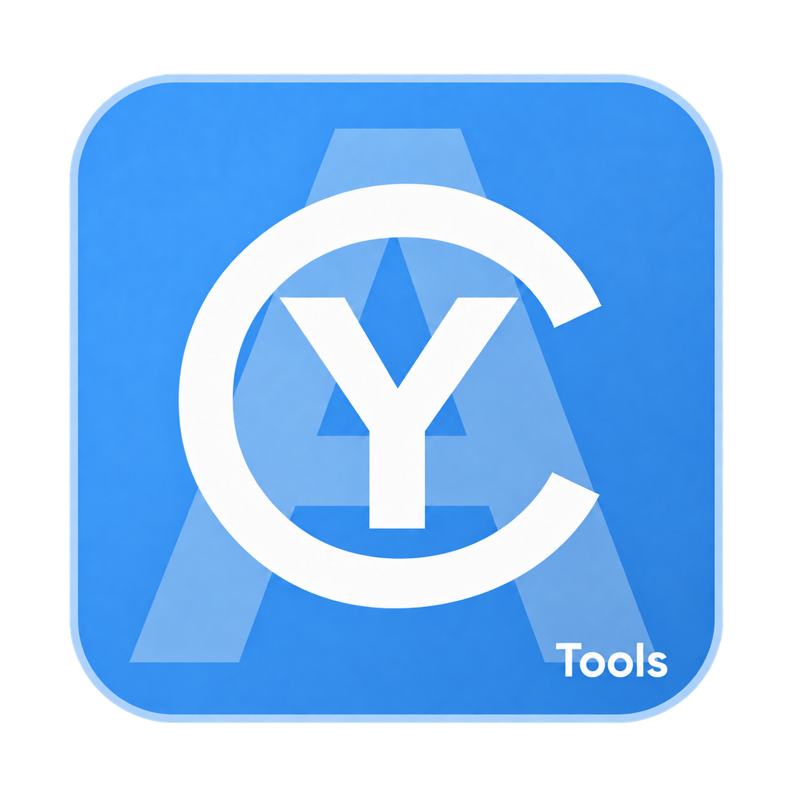

# CyToolsCore

<p align="center">
  
</p>

**English** | [Français](README.fr.md)

A standalone foundation for building CyTools: the CyTools JSON v1 standard,
a Python SDK and runtime, jobs, sessions, client isolation, resource reservations,
and CLI, JSONL, local HTTP and MCP adapters. SDK version: **0.10.1**; schema: **1**;
protocol: **1.0**.

Each Tool embeds or references this SDK. CyToolsManager, AI models, provider accounts
and graphical components are not required.

## Getting started on Windows

From this directory, with Python 3.11 or later:

```powershell
python -m venv .venv
.\.venv\Scripts\python -m pip install --keyring-provider disabled -e '.[mcp,dev]'
.\.venv\Scripts\python -m pytest -q
.\.venv\Scripts\cytool-test describe
.\.venv\Scripts\cytool-test invoke progress_test
```

On Linux/macOS, replace `.venv\Scripts\` with `.venv/bin/`.
The `mcp` extra is optional; `pip install -e .` is enough for the runtime and CLI.

## Creating a Tool

```powershell
.\.venv\Scripts\cytools new .\Examples\CyToolSample --name CyToolSample --id cy.tool.sample --desktop
.\.venv\Scripts\cytools validate .\Examples\CyToolSample\app\CyTool.json
.\.venv\Scripts\python .\Examples\CyToolSample\app\tool.py invoke echo --params-file .\Examples\CyToolSample\app\params.json
```

The `--desktop` option provides an `app/data/runtime` layout, an ImGui frontend and
native launcher sources to compile. Complete the Tool's interface, installation and
updates according to [Standalone delivery](Docs/StandaloneDelivery.md).
The Options tab includes English/French selection, theme, text size, licenses and
generation configurations that AI clients can save and reuse.

For mesh Tools, add `--mesh-viewer`: interactive result previews, orbit/free navigation,
close-up zoom and studio/sun lighting. See [Mesh viewer](Docs/MeshViewer.md) for
integration instructions and required controls.

The generator refuses to overwrite a non-empty directory. It creates `CyTool.json`,
`tool.py`, `test_tool.py`, `AGENTS.md`, `README.md`, `params.json` and installation
instructions. It also provides `CyToolsGuide.md` and a copy of the SDK documentation.
`cytools docs` locates the complete installed documentation, including when installed
from a wheel. The Tool immediately supports `describe`, `list-operations`, `invoke`,
`diagnose`, `stdio`, `serve`, `create-client` and `mcp`.

**For an AI agent creating a Tool, start with [Docs/AgentGuide.md](Docs/AgentGuide.md).**
The [ready-to-use prompt](Docs/AgentPrompt.md) provides an entry point independent of
the AI client. The human tutorial is [Creating your first CyTool](Docs/CreatingYourFirstCyTool.md).
Some detailed guides are currently available in French.

Standalone applications include selectable/copyable logs and contracts for video
resolution, derived models, LoRA adapters and CPU/GPU selection: see
[Standalone diagnostics and models](Docs/StandaloneDiagnosticsAndModels.md).

## Project layout

| Directory | Purpose |
|---|---|
| `cytools_core/schemas/` | JSON Schema 2020-12 contracts, the source of truth for the standard |
| `cytools_core/` | Validation, runtime, storage, resources, workers and downloads |
| `cytools_core/transports/` | Separate adapters using the same identity and runtime |
| `cytool_test/` | Reference Tool with seven operations and no AI dependency |
| `Tests/` | Integration, concurrency, download, worker, HTTP and real MCP tests |
| `Docs/` | Contract, tutorial, agent guide, limitations and architecture decisions |
| `Examples/` | Client and portable worker examples |

Read the [implementation status](Docs/ImplementationStatus.md) and
[validation report](Docs/Validation.md) before integrating a backend.
Native C++/C# SDKs are not shipped: those languages can already use the JSON protocol
or run as workers. Linux/macOS have a CI matrix; a local Windows test does not establish
that validation has run on those platforms.

## First tested model: CLAP

[CyToolCLAP](Tools/CyToolCLAP/README.md) is a separate Tool for classifying sounds and
music with a local model. Four public samples (dog, rain, trumpet and piano) were
tested, along with inference through MCP. Its dependencies and weights stay outside
the Core.

## Additional guides

- Local/shared storage and CUDA Toolkit: [Shared installation](Docs/SharedInstallation.md).
- Advanced access and AI orchestration: [Full operation access](Docs/FullOperationAccess.md).
- Unreal plugins and AI connectors: [CyUEMCPSDK and integrated connectors](Docs/UnrealIntegration.md).
- Targeted operation concurrency: SDK 0.10.0 introduced `exclusiveGroups`, for example
  to share a GPU while independent operations keep running. See [Scheduler](Docs/Scheduler.md).
- Updating an existing application, Tool or plugin: [Migration guide](Docs/UpdateExistingProducts.md).

## License

Copyright (C) 2026 Cyberalien.

CyToolsCore is distributed under the **MIT license** starting with version 0.10.1.
See [LICENSE](LICENSE) and the redistribution rules in [Docs/Licensing.md](Docs/Licensing.md).

You may use, modify and redistribute the SDK, including in commercial products,
provided you retain the license text and copyright notice.
It is provided without warranty, including any warranty of merchantability or fitness
for a particular purpose. Third-party dependencies and models retain their own licenses.
